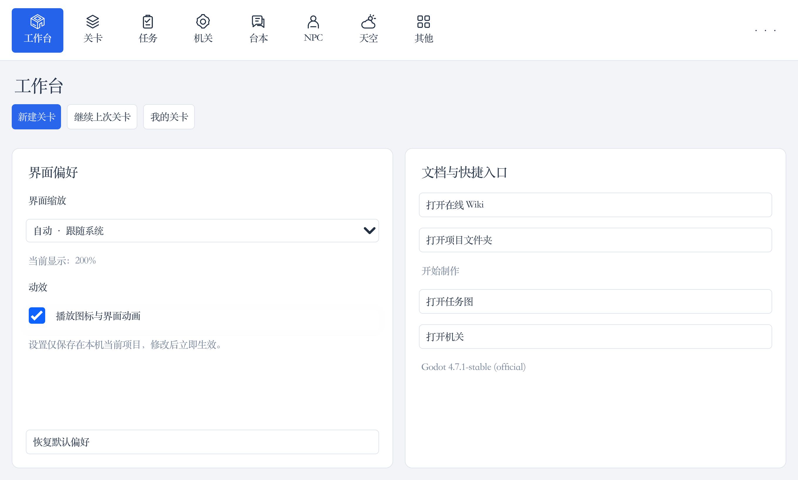

# Workspace preferences

The room icon at the left of the separate window opens **工作台** (Workspace). The window is available from the top GodotLevelEditor entry or Project → Tools. Its other pages are initialized on first use and keep their drafts afterward.

## Start building

Choose **新建关卡** to open a new inherited map in the native editor and use Save As. **继续上次关卡** reopens the last saved map you edited. Hover to see its path. Choose **我的关卡** to browse other maps.

## Display

Choose automatic scaling or a manual 100%–300% scale. Preferences are local to the current project. Reset restores automatic scaling and UI animation.

The animation option controls navigation icons, buttons and transitions without changing their hit areas. The current UI uses the available local serif font and scalable graph text. Speaker/level labels share deterministic colors and choose a readable text color.

## Help

The plugin's help opens the online Wiki. The source repository also includes `打开Wiki.command` on macOS and `python3 tools/wiki/wiki.py serve --open` for local documentation preview. See [preview and publishing](../development/publishing.md).

The project-folder action opens the current project in the file manager. Save work and reopen the project after an update so all editor scripts and resources are refreshed.
