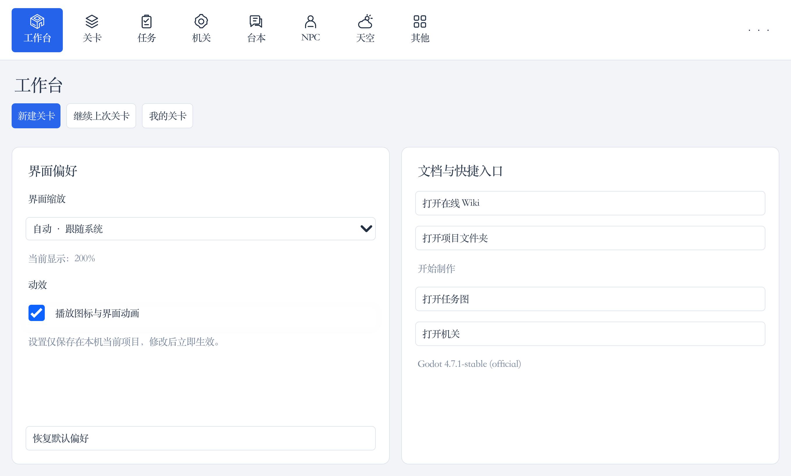

# 工作台、偏好与文档

点击“关卡”左边的 **工作台**，图标是 GodotLevelEditor 的房间标志。

打开工程后，通过顶部 **GodotLevelEditor** 或 **项目 → 工具 → 打开 GodotLevelEditor** 首次打开独立窗口，会先显示工作台。其他分类在首次访问时初始化，之后保留页面和草稿；启动时不再预先创建全部页面。详见 [启动等待说明](../faq.md#plugin-startup)。

## 新建或继续关卡

点击 **新建关卡**，用 Godot 原生另存为保存地图。**继续上次关卡** 打开最近编辑的已保存地图；悬停查看路径。点击 **我的关卡** 可以搜索其他地图。

## 调整显示

在“界面缩放”选择 **自动 · 跟随系统**，或指定 100%–300% 的比例。修改立即生效，下面显示实际比例。自动模式沿用屏幕和 Godot 编辑器的显示偏好；工作台的手动比例优先。

“播放图标与界面动画”控制导航手势、按钮和页面过渡。关闭后，图标立即回到静止状态。偏好只保存在本机当前项目；“恢复默认偏好”恢复自动缩放并开启动画。

顶部每个图标在选中时播放一次短动画，切到别处时播放较轻的回落动作。重复点击当前入口也会重播。文字位置及按钮范围保持稳定。

编辑器统一使用本机宋体，保留字号、选中加粗和放大清晰度。事件／任务表的“所属关卡”和台本的“NPC 姓名”使用自动分配的实色标签，同一关卡或姓名保持同色。标签采用蓝、青、紫色系，深色填充配白字，浅色填充配深灰字；行选中后标签文字仍保持清晰。[标签实际画面与检查](../../godot_level_editor_suite/filled_labels_2026-11-16/validation.md)。提示框、菜单和弹窗使用完整浅色外沿，避免圆角处出现黑边，见 [弹窗验证](../../godot_level_editor_suite/popup_frames_2026-11-16/validation.md)。

## 打开帮助

- **打开在线 Wiki：**在默认浏览器打开项目文档网站。
- 源码工程也可使用根目录 `打开Wiki.command` 或命令启动本地 Wiki；发行包中的帮助入口使用在线文档。首次本地运行的依赖说明见 [Wiki 预览与发布](../development/publishing.md)。
- **打开项目文件夹：**在文件管理器中定位当前工程。

“开始制作”提供任务图和机关的快捷入口。已生成本地站点时，帮助区也可打开本地 Wiki。

## 更新已有会话

先保存当前工作，再重新打开项目，以加载新增入口和图标动画。[实际截图与验证](../../godot_level_editor_suite/navigation_motion_2026-11-16/validation.md)。
