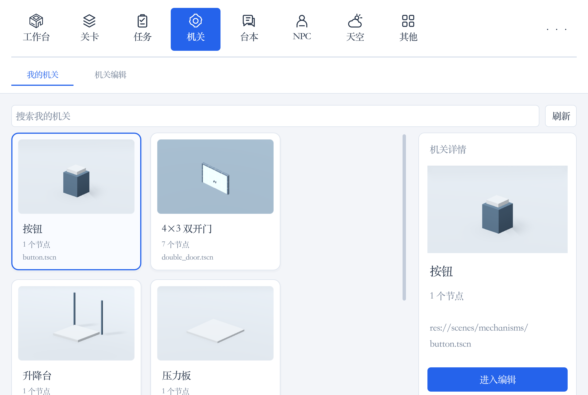

# 使用五种独立机关

准备：打开 GodotLevelEditor，进入 **机关 → 我的机关**。

预期结果：库中只有双开门、单开门、压力板、按钮和升降台。每个素材只包含自己的组件和内部状态图，没有“按钮打开滑动门”等预连线组合。

## 选择素材

| 素材 | 自己如何运行 |
|---|---|
| 双开门 | 自身交互切换开关，两扇分别转到 +90° / −90° |
| 单开门 | 自身交互切换开关，门扇转到 90° |
| 压力板 | 玩家站上时 pressed，离开后 released |
| 按钮 | 按 F 变为 pressed，按设定时间回到 idle |
| 升降台 | 在平台上按 F 前往另一端，到达后再次按 F 返回 |

目录可向下滚动，完整列表只有五种素材。

## 制作自己的版本 {#own-copy}

1. 单击卡片查看详情，双击或点击 **进入编辑**。
2. **另存为** 后修改自己的版本。门的曲线和三状态见 [旋转门教程](rotating-door.md)。
3. 点击 **新建机关** 时得到空白图，不会自动放入按钮、门或逻辑组合。
4. 在 **添加节点** 中选择五种组件之一。添加单/双开门会建立它自己的门框、门扇、动画和三状态图；不会加入外部按钮。
5. 保存后通过三维轮盘 **机关 → 已有素材** 放入关卡，F6 试玩。

## 用按钮打开指定的门 {#wire-button}

1. 从 **工作台 → 新建关卡** 创建地图并原生另存。在 3D 轮盘选择 **机关**，悬停 **关卡常驻机关** 后点击 **已有素材**，将按钮和单开门分别放在地面上。再放一扇相隔几米的门作对照，保存地图。
2. 打开 **关卡 → 我的关卡**，选择这张地图，点击 **编辑常驻逻辑**。添加 **机关交互成功时** 和 **请求机关执行动作** 两个节点。
3. 从原生场景树把按钮实例拖入第一个节点的机关框，把第一扇门拖入第二个节点的机关框。在第二个节点的参数里选择动作 `open`，点击 **应用参数**。
4. 把第一个节点的“继续”输出连接到第二个节点的“执行”输入。保存图，回原生视口按 F6，走到按钮旁按 F。第一扇门应转开，另一扇保持关闭。
5. 停止试玩，把第二扇门拖入同一个动作节点，确认动作仍是 `open` 后保存。重新 F6 并按按钮，这次应只有第二扇门转开。若两扇都不动，先核对触发节点绑定的按钮和动作节点绑定的门。

## 快速检查

打开 `content/scenes/levels/mechanism_whitebox_v1.tscn`，F6 运行。这个场景现为五种独立素材展示区，保留地面、光照和出生点。

按下按钮时，按钮自身改变状态，两扇门和升降台应保持原状。靠近门按 F，门自行开关；站上压力板观察状态；站在升降台上按 F 往返。升降台交互位置跟随平台，不需要外接终端。

在自己的地图里，可以用下面的练习把按钮和一扇门连接起来。任务可读取任意实例的真实状态；需要门完全打开时等待 `open`。

完成检查：库只有五种素材；按钮不改变其他机关；新建为空白；自己的版本能够另存、重开和试玩。

维护依据：[机关速查](../reference/mechanisms.md)、[清理与独立运行验证](../../mechanism_editor/independent_2026-11-16/validation.md)。
