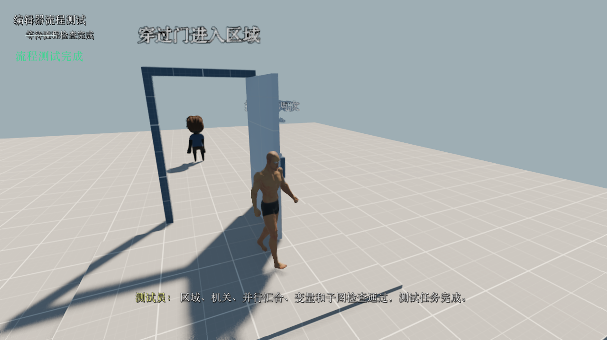

# 试玩编辑器流程测试

这个关卡用于复测从 NPC 接取事件、连续推进任务到完成的完整流程。需要当前工程和 Godot 4.7.1。预期结果是门打开、玩家进入门后区域，三个任务完成，画面出现绿色“流程测试完成”。

## 打开与试玩

1. 在 Godot 原生文件系统中打开 **content/scenes/levels/9_editor_flow_test.tscn**（关卡 9）。也可直接打开 `content/scenes/levels/9_editor_flow_test.tscn`。
2. 使用原生 **运行当前场景（F6）**。WASD 移动，靠近 NPC 或按钮后按 F 交互。
3. 走到正前方的“测试员”附近，按 F 听取说明，再按 F 结束第一段站桩对话。此时接取事件并自动检查背包与穿着。
4. 装备确认对话出现后，再按 F 继续。对话期间尝试移动，应保持站定；结束后恢复移动。左上角显示下一项任务“按两次按钮并穿过门”。
5. 走到左前方按钮附近，按 F 一次，门应保持关闭。待按钮复位、交互提示恢复，再按 F 第二次，门开始打开。
6. 门打开后，穿过门进入门后的标记区域。仅按按钮但没有进入区域时，第二项任务不会完成。
7. 留在区域内约 3 秒，等待并行计时、变量判断及子图执行。完成提示以自由对话显示并自动结束，左上角任务列表划线、淡出，出现绿色 **流程测试完成**。

停止试玩后重新 F6 可从头复测。本关的独立试玩不保存长期进度。

## 查看与修改连线

常驻图在 **关卡**；三个任务在 **任务 → 事件与任务 → 编辑器流程测试（1004）** 中打开。子图通过任务图的文件菜单打开。

| 图 | 作用 | 节点 / 连线 |
|---|---|---|
| 关卡 9 的常驻图 | 测试员互动、站桩对话、接取首项任务 | 4 / 2 |
| 1004001 检查背包与穿着 | 添加物品、穿着、条件组合、子目标、对话完成 | 12 / 10 |
| 1004002 按两次按钮并穿过门 | 计数、机关动作、等待开门、Room 条件与汇合 | 12 / 10 |
| 1004003 等待流程检查完成 | 检查点、并行计时、数值比较、子图、完成／失败出口 | 15 / 16 |
| `content/resources/task_graphs/editor_flow_test/child.tres` | 延时、设置角色状态、子图返回 | 4 / 3 |

合计 47 个节点、41 条人工鼠标连线、33 类节点。三个主任务图位于 `content/resources/task_graphs/editor_flow_test/`，独立台本位于 `content/resources/narrative/editor_flow_test.xlsx`。先另存副本再试改连线，保留这个案例用于后续复测。

## 完成检查与覆盖边界

场景内只读记录器检查事件、三个任务、按钮交互次数、门、Room、数值变量、背包、穿着、子图状态和检查点保存，共 12 项。结果写入 `docs/qa/editor_flow_2026-11-17/manual-session.json`，再次完成会覆盖记录与截图。看到普通对白“测试任务完成”后，还应确认绿色完成提示。

本次真实界面完成两遍人工试玩，并另跑 367 项模块回归。成功路径通过；失败分支和检查点恢复没有在这次人工试玩中触发，全部节点组合、所有 NPC 模型、天空编辑与 HUD 编辑操作也未在本案例中逐项手测。完整范围见 [验证记录](../../qa/editor_flow_2026-11-17/validation.md)。

## 遇到问题

- F 没有交互：先靠近目标、确认交互提示；按钮需要复位后才能再次交互。换屏后先让游戏窗口获得焦点。
- 门已开但任务不推进：进入门后标记区域，并等候约 3 秒。
- 普通对白结束但没有绿色提示：查看运行输出中的 `FLOW_SESSION_RESULT` 和上述 JSON；不要把对白文字单独当作检查通过。
- 近距离 NPC 名牌或标记文字遮挡：本轮已登记为非阻塞观察项，暂缓修复。

维护依据：[任务接口](../../narrative_editor/INTERFACES.md)、[验证记录](../../qa/editor_flow_2026-11-17/validation.md)。
