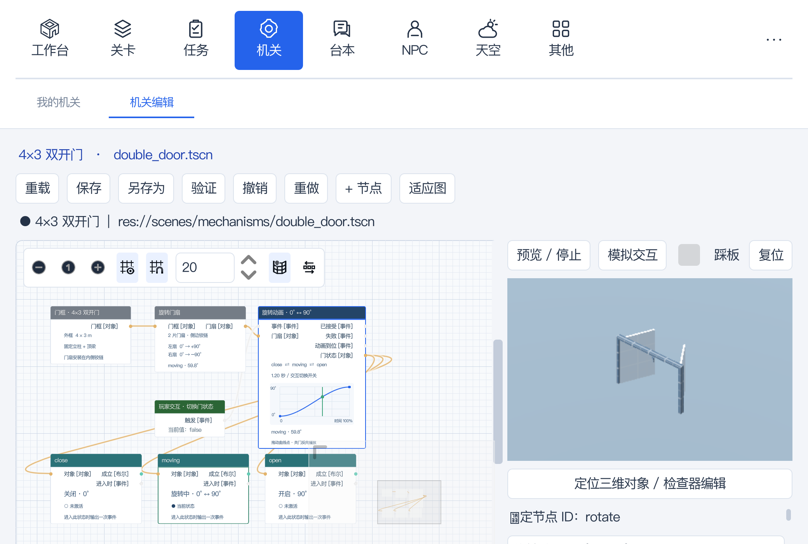

# 用节点查看并调整旋转门

准备：在 GodotLevelEditor 中打开工程，进入 **机关 → 我的机关**。

预期结果：看到独立的门框、门扇、旋转曲线与三个状态；预览中门扇从关闭位置旋转到 90°，状态从 `close` 经过 `moving` 到达 `open`。

## 打开一种门

选择 **2×3 单开门** 或 **4×3 双开门**，点击 **进入编辑**。尺寸指外框的宽和高，单位为米。单开门有一片门扇，双开门有两片门扇；门框保持固定。

制作自己的版本时先 **另存为**，再调整节点或参数。源素材分别是 `addons/godot_level_editor/scenes/mechanisms/single_door.tscn`、`addons/godot_level_editor/scenes/mechanisms/double_door.tscn`，图定义使用同名 `.graph.tres`。

也可以在已有机关的 **添加节点** 中选择这两种门：会一次创建门实体和已连好的七节点图，并放在已有节点的右侧。整套添加可以一次撤销。

## 按连线读图

图中已有七个节点：

| 节点 | 表达什么 |
|---|---|
| 门框 | 固定的两侧立柱和顶梁，标明 2×3 / 4×3 外框规格 |
| 旋转门扇 | 安装在门框内侧的铰链与门扇；单扇 +90°，双扇分别 +90° / −90° |
| 玩家交互 | 接受玩家或隔离预览的交互输入 |
| 旋转动画 | 执行开关门，显示时长、旋转曲线、当前角度和播放位置 |
| close | 门关闭且角度为 0° 时激活 |
| moving | 正在开门或关门时激活 |
| open | 门扇实际到达 90° 时激活 |

金色对象线按 **门框 → 门扇 → 动画 → 状态** 连接同一扇门。白色事件线把 **玩家交互** 接到 **旋转动画**。状态卡变绿表示当前状态成立；它的“进入时”端口只在进入瞬间触发一次。

## 编辑动画曲线

1. 选中 **旋转动画**。节点内部直接显示曲线；右侧可修改 **旋转时长**，或选择 **缓入缓出 / 匀速**。
2. 曲线横轴是整个动画的时间比例，纵轴是 0° 到 90°。左键点击曲线区添加点，拖动中间点调整运动节奏；右键删除中间点。
3. 起点 `(0,0)` 与终点 `(1,1)` 固定。默认曲线缓入缓出。关门时沿同一条曲线反向播放，中途反向从当前角度继续。
4. 点击右侧 **预览打开 / 预览关闭**，或选中门节点后点击 **模拟交互**。绿色播放线与角度数字随真实门扇更新。
5. 用 **撤销 / 重做** 检查修改，再保存。曲线属于实际门组件，多个图节点共同读取同一份曲线。

预览使用编辑场景的副本，不把 `moving` 或当前角度保存为素材的初始状态。需要初始打开时，将组件初始状态选为 `open`。

## 在关卡和任务里使用

通过三维轮盘的 **机关 → 已有素材** 选择自己的门，放进关卡后 F6 试玩，靠近门按 F。交互由图中的连线进入动画节点。

任务图和常驻关卡图选择该实例后，会提供 `close / moving / open`。请求目标使用 `close` 或 `open`；`moving` 是动画过程，只用于检测。要等门真正打开，使用 **等待机关到达状态 → open**，或监听动画节点的 **动画到位**。

“已接受”只表示开关指令已启动；中途反向会取消原动作，并从当前进度反向播放。锁定时拒绝打开，仍可执行关闭。

## 完成检查与排查

- 初始只有 `close` 激活；开门中只有 `moving` 激活；两扇都到位后 `open` 激活。
- 门框保持固定，门扇及碰撞围绕侧边铰链旋转。白盒材质默认显示米制网格。
- 没有连到动画节点的交互不会执行开门。缺失输入、不同门之间的结构错接、缺失曲线都会在验证和保存时报告。
- 保存冲突或失败时检查面板提示；操作边界见 [机关保存与复制](../reference/mechanisms.md#save-and-copy)。

当前库仅保留五种独立素材。旧组合、拉杆、终端、滑动门等已移除，节点搜索不再提供这些创建类型。已有用户关卡的必要旧实例数据留在关卡内部，不再作为库素材。

维护依据：[机关接口](../../mechanism_editor/INTERFACES.md)、[本轮验证](../../mechanism_editor/doors_v2_2026-11-16/validation.md)。
